**English** · [Русский](README.ru.md)

# SugarBridge ✧

Glucose from a FreeStyle Libre sensor, in Samsung Health. No server of your own: the app fetches readings
from the LibreLinkUp cloud and writes them to Health Connect, where Samsung Health picks them up.

<p>
  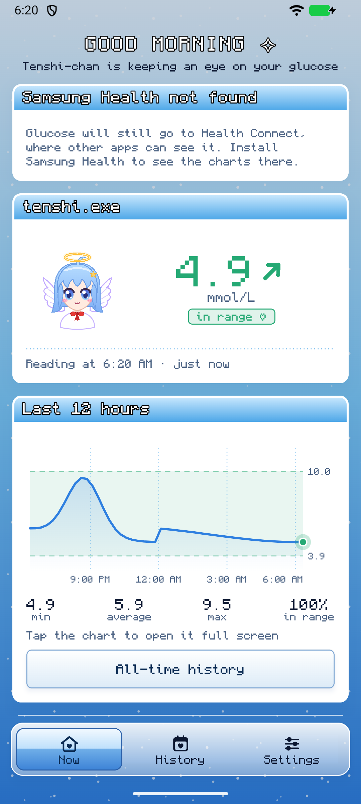
  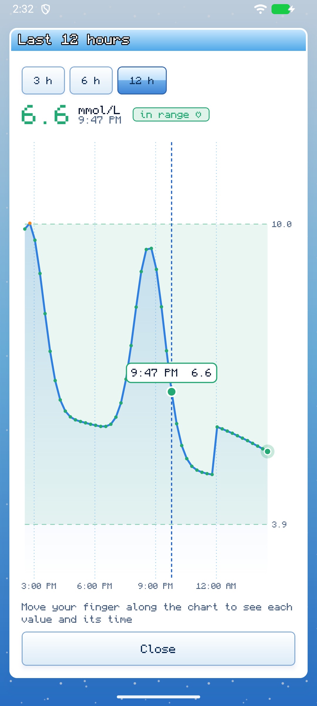
  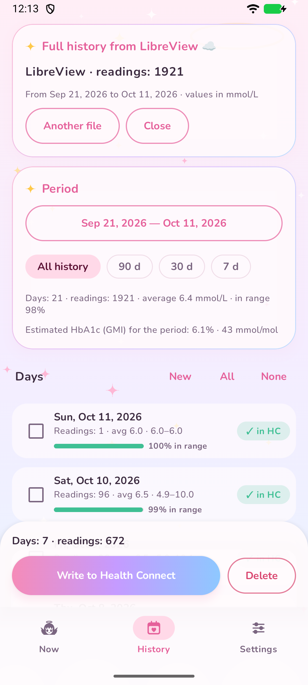
  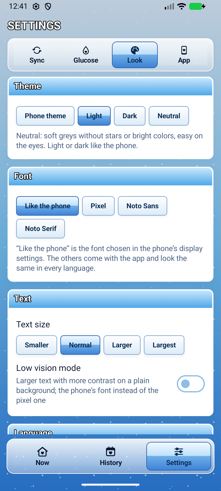
  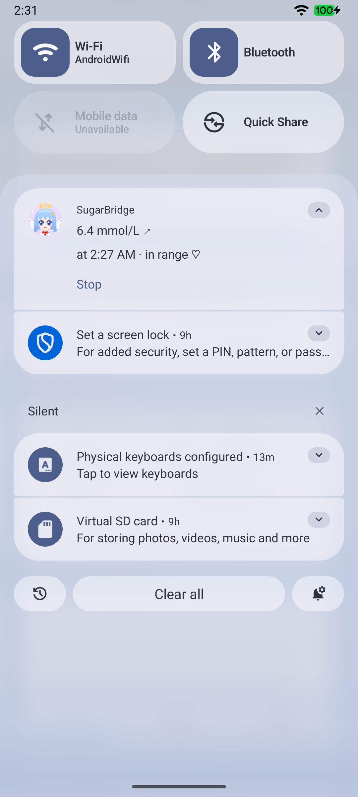
  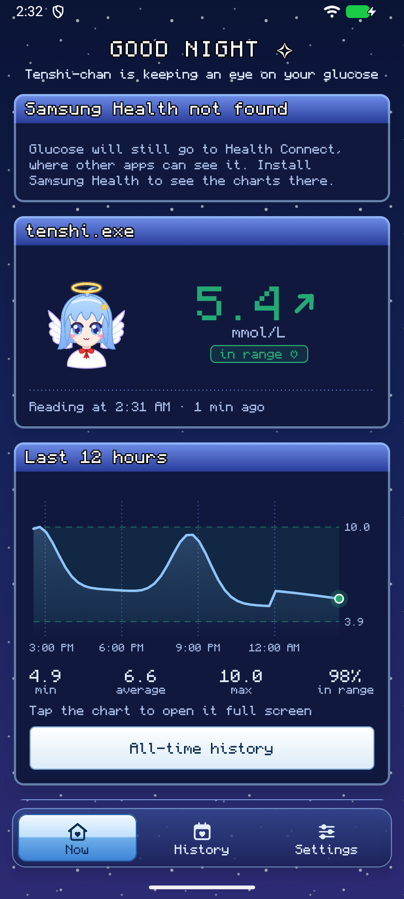
  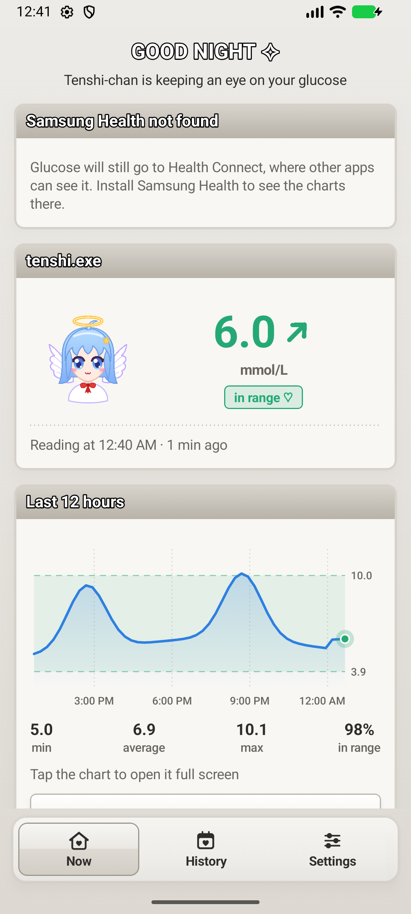
  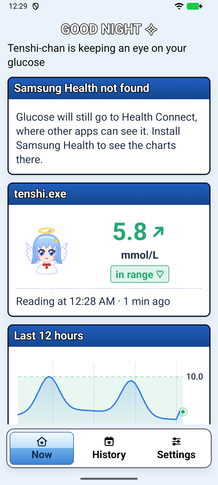
  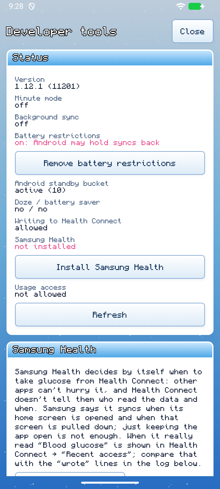
</p>

> **This is not a medical device.** Low and high glucose alarms and treatment decisions belong to the
> official LibreLink app only. SugarBridge uses the unofficial LibreLinkUp API, which Abbott may change
> without notice. The project is not affiliated with Abbott, Samsung or Google.

## Features

- **Glucose in Samsung Health**: in the background every 15 minutes (or less often), without a notification.
- **Minute mode**: every new reading goes to Samsung Health, and the glucose with its trend arrow is the
  status bar icon. In Settings → Glucose → Status bar you put the arrow over the number or beside it, make the number and
  the arrow smaller or larger (×0.8, ×0.9, ×1.1, ×1.25, each on its own) or leave either out. Background sync is
  switched off while minute mode runs and comes back when it stops. The notification follows the app's theme
  and can be made quiet or hidden completely.
- **Full history from LibreView**: download the export right in the app, look through it on a chart (a day, a
  week, a month, all of it or any period from a calendar), then choose the days you want in Samsung Health.
  Nothing is written twice, and anything unwanted can be deleted. The history stays in the app until you delete
  it; a newer export is compared with it, and you choose to add the new readings, replace the differing ones or
  replace it all. Or let it grow by itself: with "Add new readings to the history" every sync adds its readings,
  so a new export isn't needed. "All-time history" under the home chart leads straight to it.
- **Estimated HbA1c (GMI)** for 14 and 90 days with the time in range, from all the history SugarBridge has
  written to Health Connect.
- **Its own chart and statistics** for 12 hours, mmol/L or mg/dL, your own target range. Tap the chart to open it
  full screen and move a finger along it to read every value and its time.
- **Light and dark theme** in the style of [keril.art](https://keril.art/): a blue sky with a field of dots,
  windows and progress bars in the style of Windows XP (real progress fills block by block, other work shows
  blocks running through the bar). The phone's theme by default, or light or dark in Settings → Look. A
  **neutral theme** in soft greys, without stars and bright colours, is easy on the eyes; it is light or dark as
  the phone is.
- **Fonts**: the phone's own font by default (the one chosen in its display settings), or the pixel font,
  Noto Sans or Noto Serif, which come with the app and look alike in all twelve languages.
- **Readable for everyone**: four text sizes and a low vision mode with larger text, more contrast and a plain
  background; the pixel font gives way to the phone's.
- **Settings in four tabs**: Sync, Glucose, Look and App, so nothing is far to scroll to.
- **Developer tools** (Settings → App): an event log of every sync and of what Android did around it, with a
  filter by kind, kept for 1 to 14 days, and the state of everything that can hold glucose back, to find where a
  delay comes from.
- **12 languages**: English, Русский, Українська, Deutsch, Français, Español, Português, Italiano, Türkçe,
  简体中文, 日本語, 한국어. Chosen on the first start, changeable in Settings or in Android's per-app language settings.
- **The password is protected by the Android Keystore** and stays on the phone.
- **Without the internet** (Settings → Sync): the glucose can also come from apps on the phone, from LibreLink's
  notification if it shows the glucose (experimental) or from Juggluco or xDrip+, and reach Samsung Health with no
  internet at all.
- **Updates in the app**: SugarBridge finds a new version on GitHub, offers it once in a window (and, while the app is
  closed, in a notification), downloads it and hands it to Android to install. Both can be turned off in Settings.
- **Tenshi-chan**, a chibi angel mascot who is happy, worried, flustered or sleepy depending on your glucose.
  Tap her and she tilts her head, closes her eyes and smiles.

Data path: sensor → LibreLink on the phone → LibreLinkUp cloud → SugarBridge → Health Connect → Samsung Health.
Without the internet: sensor → LibreLink's notification, Juggluco or xDrip+ → SugarBridge → Health Connect →
Samsung Health.

## Compatibility

SugarBridge doesn't connect to the sensor itself: it takes what the sensor app has sent to the cloud.
So any sensor whose readings show up in LibreLinkUp works.

| | |
|---|---|
| **Sensors** | FreeStyle Libre 2 and 2 Plus, Libre 3 and 3 Plus: a new reading every minute. FreeStyle Libre (the first one): only after a scan, the 8-hour history arrives with every scan, so minute mode is useless for it |
| **Sensor app** | FreeStyle LibreLink from any country (including the Russian one), FreeStyle Libre 3, Libre (US) |
| **Follower app** | LibreLinkUp, in Russia LibreLinkUp-RU |
| **Phone** | Android 14 or newer |

**Russia and the rest of the world.** The Russian LibreView is a separate Abbott system with its own server
(libreview.ru); the rest of the world uses libreview.io with regions (Europe, US, Germany, France…).
SugarBridge first tries the server for the phone's country, then the other one, and remembers the region after
the first sign-in, so there is nothing to configure. The history window opens libreview.ru or libreview.com
depending on the account's region.

## Download

**[⬇ SugarBridge.apk, the latest version](../../releases/latest/download/SugarBridge.apk)** ·
[all versions](../../releases)

You need:
- a phone with **Android 14** or newer (Health Connect is built into the system there);
- the **LibreLink** app with a FreeStyle Libre sensor and a connected **LibreLinkUp** account (see below);
- **Samsung Health** to see the charts there. Without it the data still ends up in Health Connect.

### Installing

1. Open the link above on the phone and download `SugarBridge.apk`.
2. Open the downloaded file. Android asks to allow installing from the browser or My Files: allow it.
3. If Play Protect warns about an unknown app, choose "Install anyway".
4. **Updating:** from version 1.4.0 SugarBridge looks for updates itself: a window on the home screen (or
   Settings → App → "Check for updates") downloads the new version, and Android asks you to confirm
   the install. From 1.12.0 a new version is also offered once in a window that pops up, and while the app is
   closed in a notification; Settings → App turns off "Check for updates by itself" or "Offer to
   install". The first time Android asks to allow SugarBridge to install apps; if Play Protect blocks the app as
   one from an unknown developer, tap "More details" → "Install anyway". Older versions are updated by
   installing the new APK from the link above over them. Your sign-in and settings are kept either way.

> If you installed a SugarBridge built in Android Studio before, uninstall it first: the versions from
> Releases have a different signature, and Android won't install them over it.

### First setup

<p>
  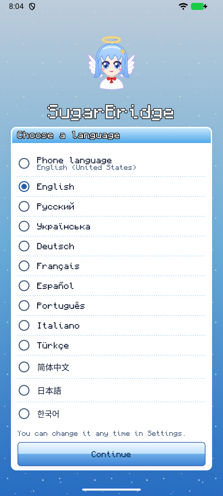
  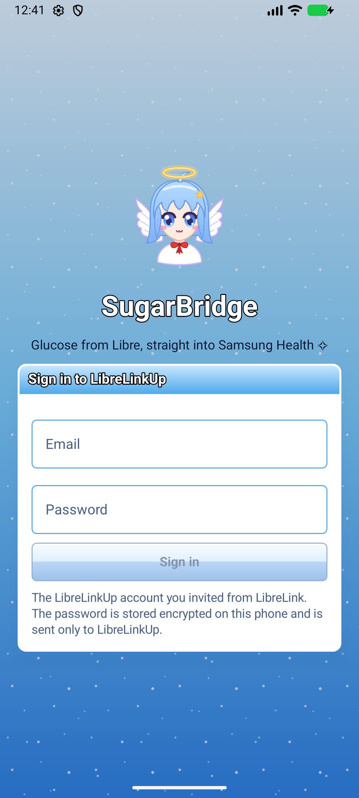
</p>

1. **Choose a language** on the first screen (or keep the phone's language).
2. **A LibreLinkUp account.** In LibreLink (or the Libre 3 app): menu → "Connected Apps" → LibreLinkUp →
   add a connection with a **second** email. Install LibreLinkUp (LibreLinkUp-RU in Russia), sign up with that
   email, accept the invitation and all the terms. After that the LibreLinkUp app itself can be removed.
3. **Sign in.** Open SugarBridge and sign in with that LibreLinkUp email and password.
4. **Health Connect.** On the home screen tap "Allow" and turn on writing blood glucose.
5. **Samsung Health.** Settings → Health Connect → let Samsung Health **read** blood glucose.
6. **"Remove battery restrictions"** (the home screen asks for it). Without it Android holds the background sync
   back for hours while the phone lies idle, and Samsung may put the app to sleep.
7. Optional: **Settings → Sync → Minute mode** for a new value every minute; "Pin the notification" brings it
   back if it is swiped away by accident. **Settings → Glucose → Status bar**: where the arrow stands and how
   large the number and the arrow are. **Settings → Look**: theme, font, text size and language.
   Minute mode switches background sync off and says so in a notice; it comes back when minute mode stops.

### Full history from LibreView

LibreLinkUp remembers only the last 12 hours. Everything else is kept in LibreView:

1. The History tab → "Open LibreView".
2. Sign in with your **LibreLink** account, the one in the sensor app, not LibreLinkUp.
3. "Glucose History" → "Download glucose data" → "I'm not a robot" → "Download".
   SugarBridge picks up the file by itself.
4. Look through it in "History chart": a day, a week, a month, all of it, or a period picked in the calendar;
   the arrows step back and forth, a tap opens the chart full screen.
5. Choose the period and the days → "Write to Health Connect". Days that are already there are marked "✓ in HC".

"Back" leads to the History start page; "View the loaded history" opens it again, also after a restart, and
"All-time history" under the home chart goes straight there. To add new days, download a fresh export the same
way: SugarBridge counts what is new, the same, different or only in the loaded history, and you choose to add the
new readings, add them and replace the differing ones, or replace the whole history with the new file. "Delete the
loaded history" removes it from SugarBridge; what is already in Health Connect stays.

Fresh readings can also go into the history without a new export: History → "Add new readings to the history".
Every sync then adds its readings, one per 15 minutes as LibreView keeps them, and an open history shows the new
days at once. Turned on, it fills the time since the end of the history from what SugarBridge has written to
Health Connect; without a history it begins one with the last 90 days of that, or with the next sync. Deleting
the history turns it off, so the next sync doesn't begin a new one.

A CSV downloaded in a browser can be opened with SugarBridge or chosen with "Choose a downloaded CSV".
Exports in any LibreView language work: the columns are recognized by their headers.

## FAQ

**How often is the glucose updated?** LibreLinkUp gets a new value about once a minute, and its 12-hour
history has a point every 15 minutes. In the background SugarBridge fetches the whole history, so nothing is
missed, but the points are 15 minutes apart. Every minute happens only in minute mode. How often LibreLinkUp
really delivers values is shown on the home screen.

**Why does glucose show up in Samsung Health late?** The path has four links, and the home screen shows two
of them: how often LibreLinkUp gets a new value and how long after the sensor reading values reach SugarBridge.
SugarBridge's own share is measured by device tests: in minute mode every new value is in Health Connect within
a minute of LibreLinkUp having it, also with the screen off in deep Doze. The background sync is different: on an
idle phone Android holds it back for hours unless the battery restrictions are removed, so do that (the home
screen asks). The last link is Samsung Health: it reads Health Connect on its own schedule, which Samsung doesn't
document, and other apps can neither hurry it nor see when it reads. Samsung says it syncs when its home screen
is opened and when that screen is pulled down; just keeping the app open is not enough, so pull its home screen
down to get the new values. Writing straight into Samsung Health, past Health Connect, is possible only with
Samsung's Health Data SDK and an access code Samsung gives out through a partnership request, which an app like
this doesn't get. To see the timing on your phone, turn on Settings → App → Developer tools: the log shows when
each value reached Health Connect, and Health Connect's own "Recent access" shows when Samsung Health read it.
SugarBridge can't put that moment into its log: Android gives the record of which app read what only to Health
Connect's own settings, not to other apps. With usage access the log's "Samsung Health" lines show when Samsung
Health was active, which is as close as an app can see.

**"Give usage access" opens a greyed-out switch.** Android 15 and newer do that for apps installed from an APK
rather than a store ("restricted settings"). Open Settings → Apps → SugarBridge → ⋮ (top right) → "Allow
restricted settings", confirm, then turn usage access on. The developer tools have a button to that page.

**Why does minute mode have a notification?** Android lets only a service with a notification run more often
than every 15 minutes. It can be made quiet (Settings → Sync → "Glucose in the notification") or turned off completely
("Hide the notification completely"); the mode keeps working.

**Do I need background sync for minute mode?** No. Minute mode already fetches every minute what background
sync (every 15 minutes or less often, no notification) would fetch, so turning minute mode on switches
background sync off. A notice at the bottom of the screen says so and stays until you tap its link to the
setting or its ✕. When minute mode is turned off, background sync comes back with the interval it had. You can
also turn it back on yourself: it does no harm, each run fetches the last 12 hours.

**Why isn't the number in the status bar larger?** Android draws every notification icon in a small square,
the same for every app, and shrinks a wider picture to fit it. So the number and the arrow share one square, and
a number is wider than tall: "6.4↗" with an arrow as tall as the digits fits only at about a third of the
square's height. Over the number the arrow takes height instead of width, so the digits come out larger: that
is the default. The largest number is the number alone: turn the arrow off, it stays in the notification. The
digits always keep the font's own proportions. Without the number only the arrow is shown; Tenshi-chan's icon
comes only without both. Two notifications (one icon each) and Android 16's Live Update capsule were tried:
the first cluttered the shade, the second wasn't drawn on Samsung phones.

**What colour is minute mode's notification?** It follows the app's theme (Settings → Look → Theme): with
"Phone theme" and the neutral theme it looks like any other notification, with the light or the dark theme its
background is light or dark whatever the phone uses.

**Why do the fonts that come with the app look the same in every language?** Each one has Chinese, Japanese and
Korean letters of the same design, so a text in any of the twelve languages isn't patched together from the
phone's fonts. They are cut to the characters of the app's texts, which keeps all of them at about 4 MB; a name
or a symbol they lack comes from the phone's font. "Like the phone" uses the font chosen in the phone's display
settings, Samsung's font styles included.

**What do the bars of the estimated HbA1c show?** The time in your target range over the 14 or 90 days, each
15 minutes weighing the same. How much of the period has readings is shown only when it is too little (under
70%) to trust the estimate. It counts the time covered by readings: Libre keeps one every 15 minutes, a minute
or two off, and a gap longer than 20 minutes counts as missing apart from its first 15 minutes.

**Can it work without Health Connect?** No, and it doesn't need to: on Android 14+ it is part of the system,
not a separate app. Writing to Samsung Health directly requires a Samsung partner key. If Health Connect is
turned off or outdated, SugarBridge shows how to fix it.

**Can it work without the internet?** In part, and only with help from another app on the phone: LibreLinkUp is
a cloud, so without the internet nothing comes from it. Settings → Sync → "Without the internet" has two ways:

- **From LibreLink's notification** (experimental). With notification access SugarBridge reads the glucose from
  the notifications of Abbott's apps, if they show it; all other notifications are skipped and none are kept.
  Whether LibreLink shows the glucose in a notification depends on its version and the sensor: Settings and the
  event log show what its notification holds, so you can see whether it works on your phone.
- **From Juggluco or xDrip+.** These apps connect to the sensor themselves and send every reading to other apps
  on the phone. Juggluco: Settings → Exchange data → Glucodata broadcast → tick `com.sugarbridge.app`. xDrip+:
  Settings → Inter-app settings → turn on "Broadcast locally" and "Compatible Broadcast", and put
  `com.sugarbridge.app` into "Identify receiver". A sensor usually connects to one app at a time: when Juggluco
  or xDrip+ takes it over, LibreLink may lose it together with its alarms, so set up the alarms there.

Readings from the phone go to Health Connect at once, also with no internet, and appear on the home screen and in
minute mode's notification; LibreLinkUp fills in the rest when the phone is online again, without writing
anything twice. Intercepting LibreLink's traffic doesn't work: its connection to Abbott is encrypted, and without
the internet it sends nothing anyway. Its data on the phone is closed to other apps, and connecting to the sensor
from SugarBridge itself would take it away from LibreLink with its alarms.

**What does the notification say when the internet is gone?** "No internet" (or "No connection to LibreLinkUp"
when the phone is online but LibreLinkUp doesn't answer), the last value with its time, and that SugarBridge tries
again by itself. Every failure is a sentence in the app's language; the technical detail is only in the event
log (Settings → App → Developer tools).

**Can HbA1c be written to Samsung Health?** No. Health Connect has no record type for HbA1c, only blood
glucose, and that's what Samsung Health gets from it. Writing to Samsung Health directly requires a Samsung
partner key. So SugarBridge shows an estimated HbA1c (GMI) itself: it is an estimate from the average sensor
glucose (Bergenstal formula, 2018), not a blood test. A lab HbA1c can be entered manually in Samsung Health.

**Health Connect's settings show SugarBridge with an old icon.** The app's icon is current: the launcher and
Android get it from the app itself. Health Connect's screens keep the icons they have loaded and don't reload
them when an app updates; Health Connect also stores an app's icon from the first time it wrote data and never
refreshes it for an installed app. The old icon shown is the one of 1.4.0, the ice fairy with a blue bow. Restart the
phone, or stop "Health Connect" in Settings → Apps (show system apps) → Force stop, and open the screen again.
If the old icon is still there, your phone shows Health Connect's stored copy: only a system update can change
that, and it has no effect on your data or permissions.

**Where does the password go?** Only to LibreLinkUp. On the phone it is encrypted with an Android Keystore key
that can't be taken off the phone. SugarBridge has no server, analytics or ads. Besides LibreLinkUp and Health
Connect it talks only to GitHub, to ask for the latest version and download it; with "Check for updates by
itself" off, only when you tap "Check for updates". With "From LibreLink's notification" on it reads only the
notifications of Abbott's apps, for the glucose in them, and keeps none. The same in short is in the app:
Settings → App → Privacy, and Health Connect's "privacy policy" link for SugarBridge opens it.

**My language is missing or a translation is off.** Open an issue or a pull request: all texts are in
`app/src/main/res/values-*/strings.xml`, and a unit test checks that every language has every string.

**Is SugarBridge on Google Play? Is there an iPhone version?** Not yet: the APK from Releases is the way to get
it, and the app updates itself from there. A Google Play build would have to leave out the self-updater (Play
doesn't let apps update themselves) and go through Play's Health apps declaration with a privacy policy. There
is no iPhone version, and this app can't become one: Health Connect and the minute service are Android parts,
and on an iPhone glucose would go to Apple Health, which would be a separate app.

Found a bug? [Open an issue](../../issues/new?template=bug_report.md) with the steps, what you expected and what
happened. The quickest way to show the cause is the event log: Settings → App → Developer tools → "Open the
tools" → "Share".

## For developers

### Building and testing

You need Android Studio (it comes with a JDK) and Android SDK 37.

```sh
./gradlew assembleDebug             # APK: app/build/outputs/apk/debug/
./gradlew testDebugUnitTest         # unit tests: a fake LibreLinkUp, CSV parsing, sync logic, translations
./gradlew lintDebug                 # Android Lint
./gradlew connectedDebugAndroidTest # on an Android 14+ phone or emulator: Health Connect, the whole chain, screenshots
```

On Windows use `gradlew.bat`. CI on GitHub runs the unit tests, Lint and the build on every push.

### Project layout

```
app/src/main/java/com/sugarbridge/app/
├── MainActivity.kt, MainViewModel.kt  the screen and its state
├── glucose/     a reading, units, target range, GMI
├── libre/       the LibreLinkUp client, response parsing, the account under the Keystore
├── libreview/   history import: CSV parsing, the site window, per-day summary
├── health/      Health Connect: writing, reading our own records, deleting
├── local/       glucose without the internet: LibreLink's notification, Juggluco and xDrip+
├── debug/       the event log and the status for the developer tools
├── sync/        sync, the background job, the minute service, autostart, errors as codes
├── settings/    settings, the theme and the app language
├── update/      updates from GitHub Releases
└── ui/          theme and fonts, components (windows, chart, the mascot), screens
app/src/main/res/values-*/  translations
app/src/main/res/font/      the fonts, cut to the app's texts by tools/make_fonts.py
app/src/test/               unit tests, laid out the same way
app/src/androidTest/        device tests
```

### Releasing a new version

GitHub Actions builds and signs the APK in Releases when a `v*` tag arrives in the repository.

1. **Once: the signing key.** Every version is signed with it; without it the app can't be updated.
   Keep the file and the passwords in a password manager, **not in the repository**:
   ```sh
   keytool -genkeypair -keystore sugarbridge.jks -alias sugarbridge -keyalg RSA -keysize 4096 -validity 36500
   ```
2. **Once: repository secrets** (Settings → Secrets and variables → Actions):
   `KEYSTORE_BASE64` (the key file in base64), `KEYSTORE_PASSWORD`, `KEY_ALIAS` (`sugarbridge`), `KEY_PASSWORD`.
   Base64 straight to the clipboard in PowerShell:
   ```powershell
   [Convert]::ToBase64String([IO.File]::ReadAllBytes("sugarbridge.jks")) | Set-Clipboard
   ```
3. **Every release:** add the version's section to [CHANGELOG.md](CHANGELOG.md), then
   ```sh
   git tag v1.14.0
   git push origin v1.14.0
   ```
   A few minutes later `SugarBridge.apk` appears in Releases with the notes from the CHANGELOG.

A signed APK can be built locally too: put `sugarbridge.keystore`, `sugarbridge.keystorePassword`,
`sugarbridge.keyAlias` and `sugarbridge.keyPassword` into `~/.gradle/gradle.properties` (outside the repository)
and run `./gradlew assembleRelease -Psugarbridge.version=1.14.0`.

## Feedback

You can reach the developer through the contacts in Settings → App → Feedback: email, Discord, Telegram. The
developer's website: [keril.art](https://keril.art/). Bugs and ideas are welcome in the
[issues](https://github.com/Keril3/sugarbridge/issues) too.

## Thanks

- Descriptions of the unofficial API: [pylibrelinkup](https://github.com/robberwick/pylibrelinkup),
  [libreview-unofficial](https://github.com/FokkeZB/libreview-unofficial),
  [a LibreLinkUp HTTP dump](https://gist.github.com/khskekec/6c13ba01b10d3018d816706a32ae8ab2).
- The look of [keril.art](https://keril.art/).
- [GlucoDataHandler](https://github.com/pachi81/GlucoDataHandler), whose code documents the broadcasts of Juggluco and xDrip+.
- The [Monocraft](https://github.com/IdreesInc/Monocraft) font by Idrees Hassan; [Noto Sans, Noto Serif](https://github.com/notofonts)
  and their Chinese, Japanese and Korean versions by Google and Adobe; [Fusion Pixel Font](https://github.com/TakWolf/fusion-pixel-font)
  by TakWolf for the pixel font in Chinese, Japanese and Korean. All under the SIL Open Font License, cut to the
  characters the app needs; see [licenses/](licenses/).

## License

[MIT](LICENSE). The fonts are distributed under their own OFL licenses. FreeStyle, Libre, LibreLink,
LibreLinkUp and LibreView are trademarks of Abbott; Samsung Health is a trademark of Samsung; Health Connect
of Google.
