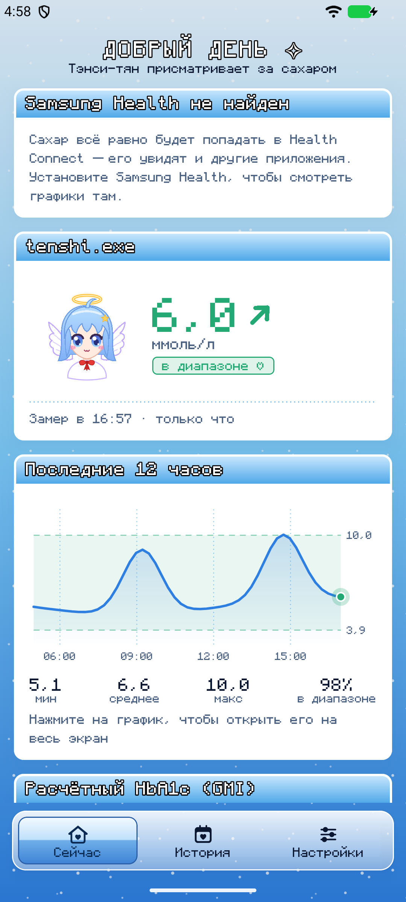
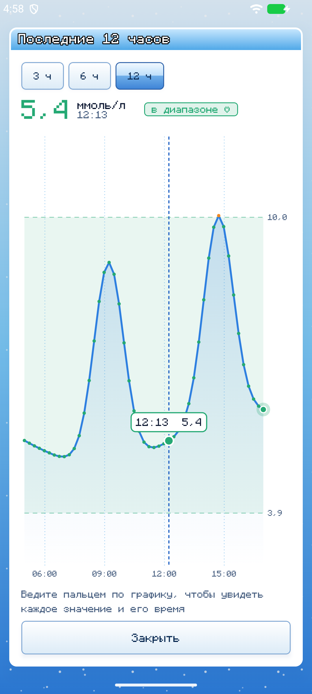
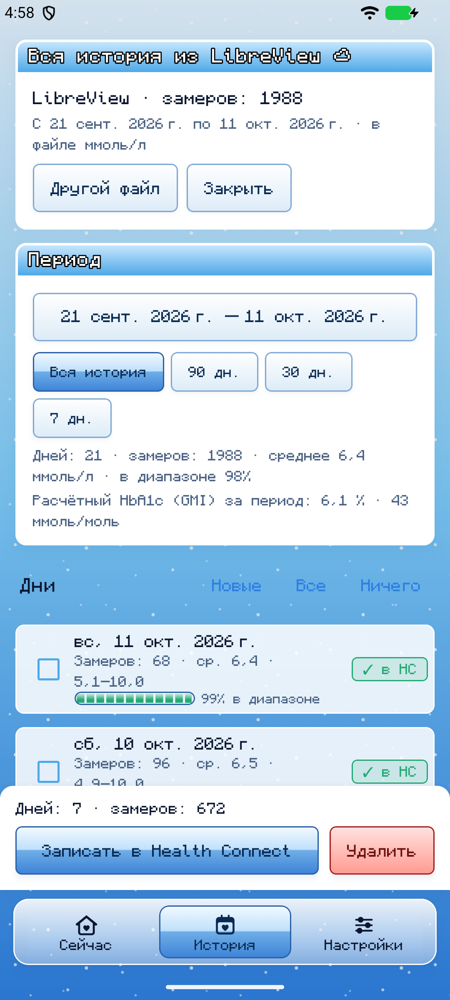
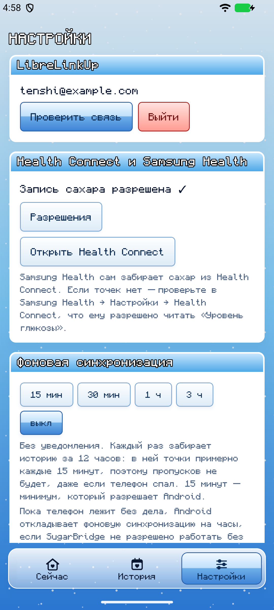
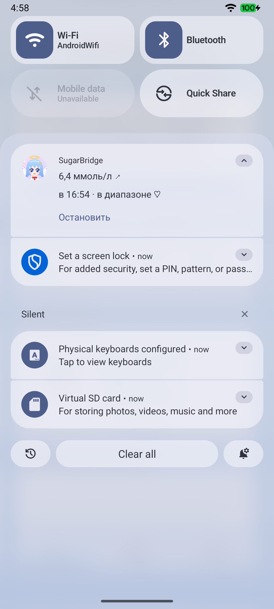
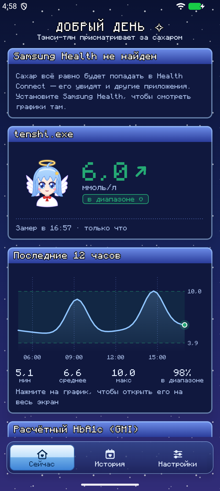

[English](README.md) · **Русский**

# SugarBridge ✧

Сахар с датчика FreeStyle Libre — в Samsung Health. Без своего сервера: приложение само забирает
замеры из облака LibreLinkUp и пишет их в Health Connect, а оттуда их берёт Samsung Health.

<p>
  
  
  
  
  
  
</p>

> **Это не медицинское изделие.** Тревоги о низком и высоком сахаре и решения о лечении — только по
> официальному приложению LibreLink. SugarBridge работает через неофициальный API LibreLinkUp, который
> Abbott может поменять без предупреждения. Проект не связан с Abbott, Samsung и Google.

## Что умеет

- **Сахар в Samsung Health** — в фоне раз в 15 минут (можно реже) без уведомления в шторке.
- **Минутный режим** — каждый новый замер попадает в Samsung Health, а сахар со стрелкой виден
  числом в строке состояния. Уведомление можно сделать тихим или скрыть совсем.
- **Вся история из LibreView** — скачайте выгрузку прямо в приложении, выберите период и дни, которые
  нужны в Samsung Health. Повторы не задваиваются, ненужное можно удалить.
- **Расчётный HbA1c (GMI)** за 14 и 90 дней — по всей истории, которую SugarBridge записал в Health Connect.
- **Свой график и статистика** за 12 часов, ммоль/л или мг/дл, свой целевой диапазон. Нажмите на график —
  он откроется на весь экран, а пальцем по нему видно каждое значение и его время.
- **Светлая и тёмная тема** в стиле [keril.art](https://keril.art/): голубое небо в точку, окна в духе
  Windows XP и пиксельный шрифт. По умолчанию — как на телефоне, в настройках можно выбрать светлую или тёмную.
- **12 языков**: English, Русский, Українська, Deutsch, Français, Español, Português, Italiano, Türkçe,
  简体中文, 日本語, 한국어. Язык выбирается при первом запуске, поменять его можно в настройках приложения
  или в системных настройках языка приложений.
- **Пароль под защитой Android Keystore**, хранится только на телефоне.
- **Обновления прямо в приложении**: SugarBridge находит новую версию на GitHub, скачивает её и передаёт Android на установку.
- **Тэнси-тян** — ангелочек в стиле чиби: радуется, волнуется, смущается или спит в зависимости от сахара.
  Если на неё нажать, она наклонит голову, зажмурится и улыбнётся.

Путь данных: датчик → LibreLink на телефоне → облако LibreLinkUp → SugarBridge → Health Connect →
Samsung Health.

## Совместимость

SugarBridge не подключается к датчику сам — он берёт то, что приложение с датчиком отправило в облако.
Поэтому подходит любой датчик, чьи замеры видны в LibreLinkUp.

| | |
|---|---|
| **Датчики** | FreeStyle Libre 2 и 2 Plus, Libre 3 и 3 Plus — новый замер каждую минуту. FreeStyle Libre (первый) — только после сканирования: история за 8 часов приходит при каждом скане, минутный режим для него бесполезен |
| **Приложение с датчиком** | FreeStyle LibreLink любой страны (в том числе российское), FreeStyle Libre 3, Libre (США) |
| **Наблюдение** | LibreLinkUp, в России — LibreLinkUp-RU |
| **Телефон** | Android 14 и новее |

**Россия и остальной мир.** Российский LibreView — отдельная система Abbott со своим сервером
(libreview.ru), у остального мира — libreview.io с регионами (Европа, США, Германия, Франция…).
SugarBridge сначала пробует сервер по стране телефона, потом второй, а регион запоминает после первого
входа — ничего настраивать не нужно. Окно истории открывает libreview.ru или libreview.com по
региону аккаунта.

## Скачать

**[⬇ SugarBridge.apk — последняя версия](../../releases/latest/download/SugarBridge.apk)** ·
[все версии](../../releases)

Что нужно:
- телефон на **Android 14** или новее (там Health Connect уже встроен в систему);
- приложение **LibreLink** с датчиком FreeStyle Libre и подключённым **LibreLinkUp** (см. ниже);
- **Samsung Health** — чтобы смотреть графики там. Без него данные всё равно будут в Health Connect.

### Установка

1. Откройте ссылку выше на телефоне и скачайте `SugarBridge.apk`.
2. Откройте скачанный файл. Android попросит разрешить установку из браузера или «Моих файлов» — разрешите.
3. Если Play Защита предупредит о неизвестном приложении, выберите «Всё равно установить».
4. **Обновление:** с версии 1.4.0 SugarBridge сам проверяет обновления: окно на главном экране (или Настройки →
   «О SugarBridge» → «Проверить обновления») скачивает новую версию, а Android просит подтвердить установку.
   В первый раз Android попросит разрешить SugarBridge устанавливать приложения; если Play Защита заблокирует
   приложение как от неизвестного разработчика — «Подробнее» → «Всё равно установить». Старые версии обновляются
   установкой нового APK по ссылке выше поверх. Вход и настройки сохраняются в обоих случаях.

> Если раньше вы ставили SugarBridge, собранный в Android Studio, сначала удалите его: у версий из
> Releases другая подпись, и поверх Android их не поставит.

### Первая настройка

1. **Язык.** На первом экране выберите язык (или оставьте язык телефона).
2. **Аккаунт LibreLinkUp.** В LibreLink (или приложении Libre 3): меню → «Подключенные приложения» →
   LibreLinkUp → добавить подключение и указать **второй** email. Установите LibreLinkUp (в России —
   LibreLinkUp-RU), зарегистрируйтесь на этот email, примите приглашение и все условия. После этого
   само приложение LibreLinkUp можно удалить.
3. **Вход.** Откройте SugarBridge и войдите email и паролем этого аккаунта LibreLinkUp.
4. **Health Connect.** На главном экране нажмите «Разрешить» и включите запись уровня глюкозы.
5. **Samsung Health.** Настройки → Health Connect → разрешите Samsung Health **читать** уровень глюкозы.
6. **«Снять ограничения батареи»** (главный экран попросит сам). Без этого Android на часы откладывает фоновую
   синхронизацию, пока телефон лежит без дела, а Samsung может усыплять приложение.
7. По желанию: **Настройки → Минутный режим** — новое значение каждую минуту; «Закрепить уведомление» вернёт
   его, если случайно смахнуть.

### Вся история из LibreView

LibreLinkUp помнит только последние 12 часов. Всё остальное хранится в LibreView:

1. Вкладка «История» → «Открыть LibreView».
2. Войдите аккаунтом **LibreLink** — тем, что в приложении с датчиком, а не LibreLinkUp.
3. «История глюкозы» → «Загрузить данные о глюкозе» → «Я не робот» → «Загрузить».
   SugarBridge сам заберёт файл.
4. Выберите период и дни → «Записать в Health Connect». Дни, которые уже есть, отмечены «✓ в HC».

CSV, скачанный в браузере, можно открыть через SugarBridge или выбрать кнопкой «Выбрать скачанный CSV».
Подходят выгрузки на любом языке LibreView: колонки узнаются по заголовкам.

## Частые вопросы

**Как часто обновляется сахар?** LibreLinkUp получает новое значение примерно раз в минуту, а его
история за 12 часов — это точки каждые 15 минут. В фоне SugarBridge забирает всю историю, поэтому
пропусков нет, но точки идут раз в 15 минут. Каждую минуту — только в минутном режиме. Насколько часто
LibreLinkUp на самом деле присылает значения, видно на главном экране.

**Почему сахар приходит в Samsung Health с задержкой?** В цепочке четыре звена, и два из них видно на главном
экране: как часто LibreLinkUp получает новое значение и через сколько после замера датчиком значения доходят до
SugarBridge. Долю самого SugarBridge измеряют тесты на устройстве: в минутном режиме каждое новое значение
попадает в Health Connect не позже чем через минуту после того, как оно появилось в LibreLinkUp, — в том числе
при выключенном экране в глубоком сне (Doze). С фоновой синхронизацией иначе: пока телефон лежит без дела, Android
откладывает её на часы, если не снять ограничения батареи, — снимите (главный экран попросит). Последнее звено —
Samsung Health: он читает Health Connect по своему расписанию, которое Samsung не публикует; если открыть
Samsung Health, он подтянет новые данные.

**Почему в минутном режиме есть уведомление?** Чаще раза в 15 минут Android разрешает работать в фоне
только сервису с уведомлением. Его можно сделать тихим (Настройки → «Сахар в уведомлении») или
выключить совсем (кнопка «Скрыть уведомление совсем») — режим продолжит работать.

**Можно ли без Health Connect?** Нет, и не нужно: на Android 14+ это часть системы, а не отдельное
приложение. Писать в Samsung Health напрямую можно только с ключом партнёра Samsung. Если
Health Connect выключен или устарел, SugarBridge покажет, как это исправить.

**А брать сахар прямо из LibreLink, без облака?** LibreLink никому не отдаёт данные, а подключиться
к датчику напрямую значит отобрать его у LibreLink вместе с тревогами и выгрузкой в облако. Минутный
режим через LibreLinkUp даёт тот же результат безопасно.

**Можно ли записывать HbA1c в Samsung Health?** Нет. В Health Connect нет типа записи для HbA1c —
только уровень глюкозы, и Samsung Health получает оттуда именно его. Писать в Samsung Health напрямую
можно только с ключом партнёра Samsung. Поэтому SugarBridge показывает расчётный HbA1c (GMI) у себя:
это оценка по средней глюкозе с датчика (формула Bergenstal, 2018), а не анализ крови. Лабораторный
HbA1c в Samsung Health можно внести вручную в разделе «Уровень сахара».

**Куда уходит пароль?** Только в LibreLinkUp. На телефоне он зашифрован ключом Android Keystore,
который нельзя достать из телефона. Своего сервера, аналитики и рекламы у SugarBridge нет.

**Нет моего языка или перевод неточный.** Заведите issue или pull request: все тексты лежат в
`app/src/main/res/values-*/strings.xml`, а unit-тест проверяет, что в каждом языке есть все строки.

Нашли ошибку? [Заведите issue](../../issues/new?template=bug_report.md): шаги, что ожидали, что
получилось, кусок Logcat по тегу `SugarSync`.

## Для разработчиков

### Сборка и тесты

Нужны Android Studio (с ней идёт JDK) и Android SDK 37.

```sh
./gradlew assembleDebug             # APK: app/build/outputs/apk/debug/
./gradlew testDebugUnitTest         # unit-тесты: поддельный LibreLinkUp, разбор CSV, синхронизация, переводы
./gradlew lintDebug                 # Android Lint
./gradlew connectedDebugAndroidTest # на телефоне или эмуляторе Android 14+: Health Connect, вся цепочка, скриншоты
```

На Windows — `gradlew.bat`. CI на GitHub гоняет unit-тесты, Lint и сборку на каждый push.
Комментарии в коде и сообщения коммитов — на английском.

### Устройство проекта

```
app/src/main/java/com/sugarbridge/app/
├── MainActivity.kt, MainViewModel.kt  экран и его состояние
├── glucose/     замер, единицы, целевой диапазон, GMI
├── libre/       клиент LibreLinkUp, разбор ответов, аккаунт под Keystore
├── libreview/   импорт истории: разбор CSV, окно сайта, сводка по дням
├── health/      Health Connect: запись, чтение своих записей, удаление
├── sync/        синхронизация, фоновая задача, минутный сервис, автозапуск, ошибки в виде кодов
├── settings/    настройки, тема и язык приложения
├── update/      обновления из GitHub Releases
└── ui/          theme — оформление, components — окна, график, маскот, screens — экраны
app/src/main/res/values-*/  переводы
app/src/test/               unit-тесты, разложены так же
app/src/androidTest/        тесты на устройстве
```

### Выпуск новой версии

APK в Releases собирает и подписывает GitHub Actions, когда в репозиторий приходит тег `v*`.

1. **Один раз — ключ подписи.** Им подписываются все версии, без него обновить приложение не выйдет.
   Храните файл и пароли в менеджере паролей, **не в репозитории**:
   ```sh
   keytool -genkeypair -keystore sugarbridge.jks -alias sugarbridge -keyalg RSA -keysize 4096 -validity 36500
   ```
2. **Один раз — секреты репозитория** (Settings → Secrets and variables → Actions):
   `KEYSTORE_BASE64` — файл ключа в base64, `KEYSTORE_PASSWORD`, `KEY_ALIAS` (`sugarbridge`), `KEY_PASSWORD`.
   Base64 в PowerShell сразу в буфер обмена:
   ```powershell
   [Convert]::ToBase64String([IO.File]::ReadAllBytes("sugarbridge.jks")) | Set-Clipboard
   ```
3. **Каждый выпуск:** допишите раздел версии в [CHANGELOG.md](CHANGELOG.md) (на английском), затем
   ```sh
   git tag v1.5.0
   git push origin v1.5.0
   ```
   Через несколько минут в Releases появится `SugarBridge.apk` с описанием из CHANGELOG.

Подписанный APK можно собрать и у себя: пропишите в `~/.gradle/gradle.properties` (вне репозитория)
`sugarbridge.keystore`, `sugarbridge.keystorePassword`, `sugarbridge.keyAlias`, `sugarbridge.keyPassword`
и запустите `./gradlew assembleRelease -Psugarbridge.version=1.5.0`.

## Благодарности

- Описания неофициального API: [pylibrelinkup](https://github.com/robberwick/pylibrelinkup),
  [libreview-unofficial](https://github.com/FokkeZB/libreview-unofficial),
  [HTTP-дамп LibreLinkUp](https://gist.github.com/khskekec/6c13ba01b10d3018d816706a32ae8ab2).
- Оформление [keril.art](https://keril.art/).
- Шрифт [Monocraft](https://github.com/IdreesInc/Monocraft) Идриса Хассана — SIL Open Font License, см. [licenses/](licenses/).

## Лицензия

[MIT](LICENSE). Шрифт Monocraft распространяется по своей лицензии OFL. FreeStyle, Libre, LibreLink,
LibreLinkUp и LibreView — товарные знаки Abbott; Samsung Health — Samsung; Health Connect — Google.
